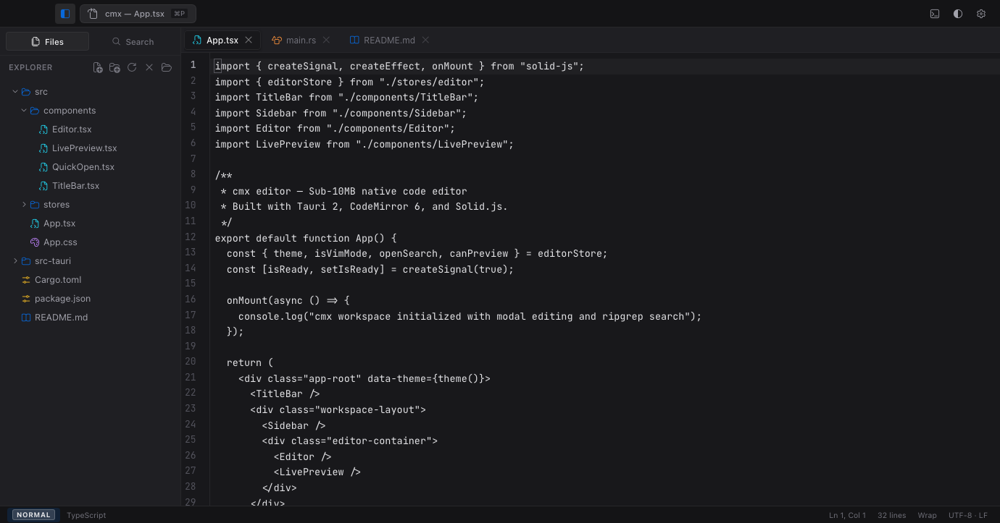
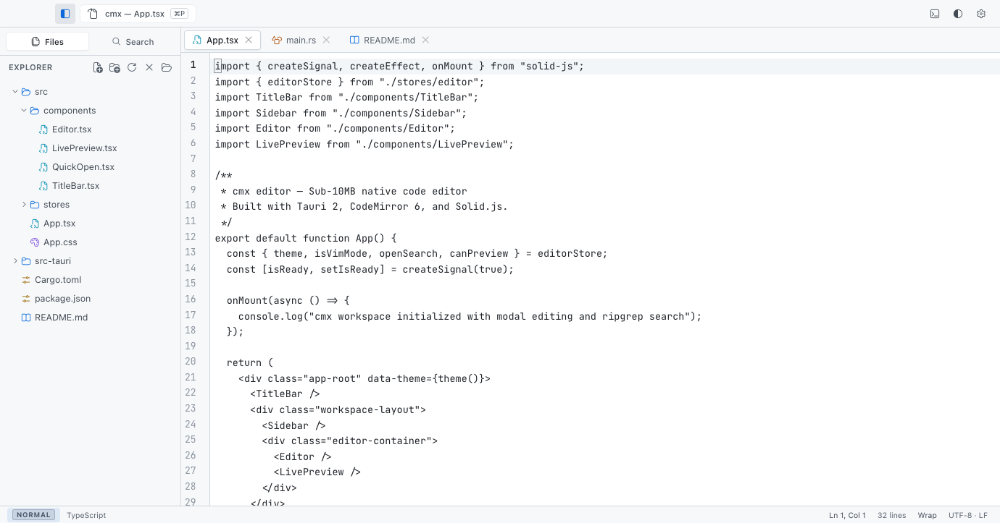
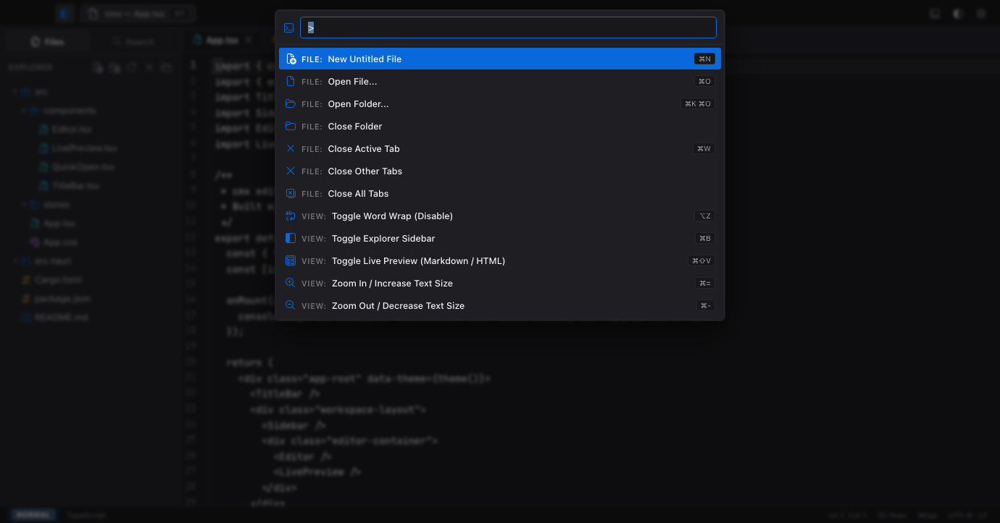
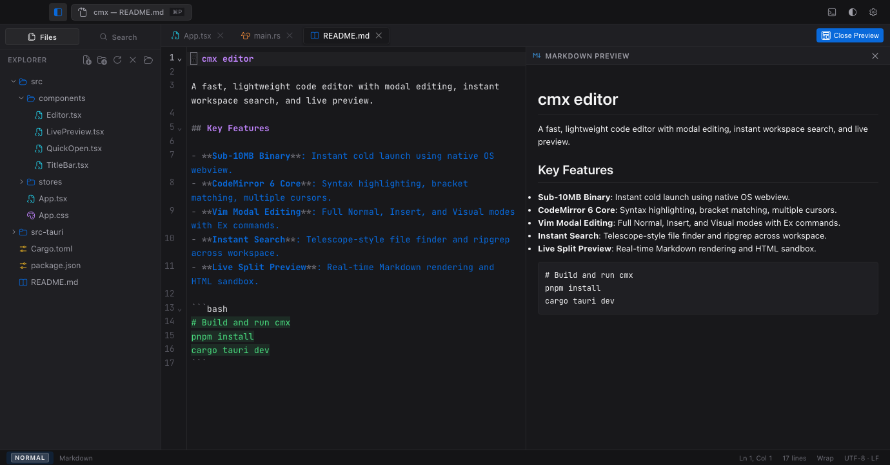
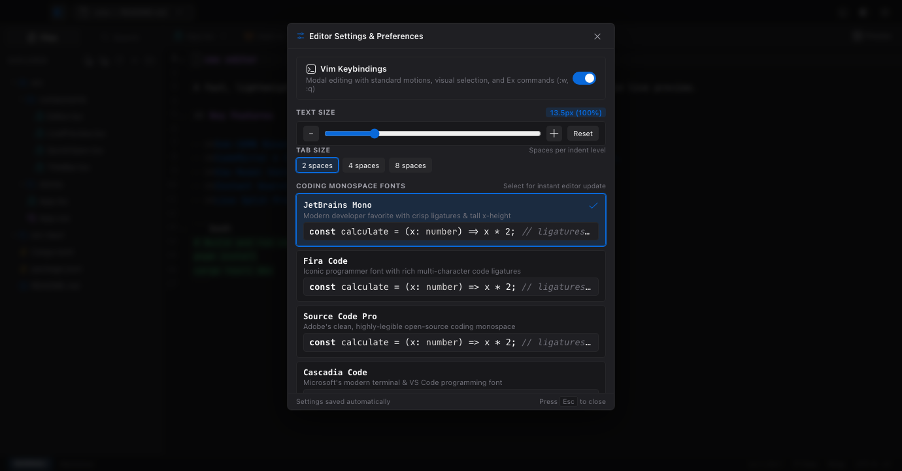

<h1 align="center">CMX</h1>

<p align="center">
  <b>A lightweight code editor engineered for speed.<br>
  Powered by Rust and the native OS webview with Vim mode, workspace search, and live preview.</b>
</p>

<p align="center">
  <a href="#install"></a>
</p>

<p align="center">
  <a href="https://github.com/chaitmudunuri/cmx/releases/latest"></a>
  <a href="https://chaitmudunuri.github.io/cmx/"></a>
  <a href="LICENSE"></a>
  <a href="#install"></a>
</p>

**CMX is a code editor for macOS, Linux and Windows.** It gives you the
fundamentals you'd actually miss — Vim mode, a file explorer, Quick Open,
workspace search and live preview — while staying out of your way: a **~7 MB
release binary, ~95 MB RSS, ~2.4 s cold start**. CMX renders in the OS webview,
so there is no browser runtime to download, patch or ship.

<p align="center">
  <a href="#screenshots"></a>
</p>

---

## Contents

- [Why CMX](#why-cmx)
- [Install](#install) — [macOS](#macos) · [Linux](#linux) · [Windows](#windows) · [Build from source](#build-from-source)
- [Screenshots](#screenshots)
- [Features](#features) — [Editing](#editing) · [Vim mode](#vim-mode) · [Navigation](#navigation) · [Live preview](#live-preview) · [Status bar](#status-bar)
- [Shortcuts](#shortcuts)
- [Performance](#performance)
- [Roadmap](#roadmap)
- [Project layout](#project-layout)
- [Contributing](#contributing)

## Why CMX

Most editors make you choose: a feature-packed desktop app that is slow and heavy, or a
web-based one that is fast but runs in a browser tab. CMX gives you a lightweight,
high performance editor without the trade-offs.

| | Electron-based editors | Web-based editors | **CMX** |
|---|---|---|---|
| Ships a browser runtime | Yes — 100–200 MB+ | n/a | **No** |
| Install size | Large | n/a | **~7 MB binary · 3.6 MB `.dmg`** |
| Cold start | ~1–3 s | Fast, but a tab | **~2.4 s** |
| Idle memory | 150–400 MB | Depends on host | **~95 MB RSS** |
| Vim mode | Via extension | Inconsistent | **Built in — 3 levels** |
| Workspace search | Built in | Host-dependent | **Built in — no external `rg` needed** |
| Live preview | Via extension | Often absent | **Built in — `⌘⇧V`** |

A few details that matter in practice:

- **No browser runtime to own.** CMX renders in the OS webview — WebKit on
  macOS, WebKitGTK on Linux, WebView2 on Windows. You don't pay to download it,
  and Chromium CVEs don't apply to a runtime CMX doesn't ship.
- **No external `rg` install.** Workspace search is implemented in Rust on
  ripgrep's `ignore` walker, so it respects `.gitignore` out of the box on every
  platform — no `brew install ripgrep`, no broken symlinks in `$PATH`.
- **Language packs load on demand.** Opening a Rust file never waits on the
  Python grammar. The initial bundle is ~190 KB gzipped.
- **Vim mode is off by default, and meant to be.** Turn it on when you want it;
  the plain-editor experience stays clean for everyone else.

## Install

<a href="https://github.com/chaitmudunuri/cmx/releases/latest"></a>

### Platform support

This is the honest state of CMX **v0.1.0**. Downloads are only listed where a
binary actually exists — see the [roadmap](#roadmap) for what is coming.

| Platform | Prebuilt download | Status |
|---|---|---|
| macOS (Apple Silicon) | `.dmg` | ✅ Available in every release |
| macOS (Intel) | — | Builds from source; universal binary is on the [roadmap](#roadmap) |
| Linux (x86_64) | — | Builds from source; `.deb` and AppImage are the next [release milestone](#roadmap) |
| Windows (x86_64) | — | Builds from source; NSIS installer is on the [roadmap](#roadmap) |

Every platform below works today via **build from source** — that path is tested
on all three in CI.

### macOS

Grab the `.dmg` from the [latest release](https://github.com/chaitmudunuri/cmx/releases/latest)
and drag **cmx editor** into Applications:

```sh
# Apple Silicon — replace 0.1.0 with the release you want
curl -fLo cmx.dmg \
  https://github.com/chaitmudunuri/cmx/releases/download/v0.1.0/cmx.editor_0.1.0_aarch64.dmg
hdiutil attach cmx.dmg && cp -R "cmx editor.app" /Applications/
```

Then launch it from Applications, or from the terminal:

```sh
open -a "cmx editor" ~/your/project
```

> **Unsigned build.** macOS will refuse to open it on first launch. Use
> right-click → Open, or `xattr -dr com.apple.quarantine "/Applications/cmx editor.app"`.
> Signing and notarization are on the [roadmap](#roadmap).

### Linux

No `.deb` or AppImage is published yet, so build from source. Install the
WebKitGTK toolchain first:

```sh
# Debian / Ubuntu
sudo apt install libwebkit2gtk-4.1-dev build-essential curl wget file \
  libxdo-dev libssl-dev libayatana-appindicator3-dev librsvg2-dev

# Fedora
sudo dnf install webkit2gtk4.1-devel openssl-devel libxdo-devel \
  libappindicator-gtk3-devel librsvg2-devel
```

Then follow [build from source](#build-from-source). You can also produce local
packages immediately:

```sh
pnpm tauri build    # writes .deb, .rpm and AppImage to src-tauri/target/release/bundle/
```

### Windows

No installer is published yet, so build from source. You need
[Rust](https://rustup.rs), Node 20+ and the
[WebView2 runtime](https://developer.microsoft.com/microsoft-edge/webview2/)
(pre-installed on Windows 11). From PowerShell:

```powershell
git clone https://github.com/chaitmudunuri/cmx.git
cd cmx
corepack enable
pnpm install
pnpm tauri dev
```

### Build from source

Prerequisites: **Node 20+** with [pnpm](https://pnpm.io), and **Rust stable**
(macOS: `xcode-select --install`; Linux: see above). Full platform prerequisites
are listed in the [Tauri docs](https://v2.tauri.app/start/prerequisites/).

```sh
git clone https://github.com/chaitmudunuri/cmx.git
cd cmx

pnpm install
pnpm tauri dev      # Vite + Tauri with hot reload (http://127.0.0.1:1420)
pnpm build          # frontend bundle only (~2s)
pnpm tauri build    # release bundles for the current platform
```

Bundles land in `src-tauri/target/release/bundle/`.

Useful checks:

```sh
npx tsc --noEmit                    # frontend typecheck
cd src-tauri && cargo test          # search ranking, match context, preview bounds
pnpm bench --runs 5                 # cold start / CPU / RSS profile
```

## Screenshots

### Quick Open — `⌘P`

Quick Open ranks the files in the open workspace as you type. The command
palette lives behind the same key.

<a href="docs/screenshots/03-quick-open.png"></a>

### Workspace search and live preview — `⌘⇧F` / `⌘⇧V`

Workspace search groups matches by file with surrounding context. Live preview
renders the document beside the source, split with a draggable resizer.

<a href="docs/screenshots/04-search-preview.png"></a>

### Settings — `⌘,`

Vim mode level, text size, tab size and font — each previewed as you change it.

<a href="docs/screenshots/05-settings.png"></a>

> Capturing new screenshots? See [`docs/screenshots/SHOT-LIST.md`](docs/screenshots/SHOT-LIST.md).

## Features

### Editing
- CodeMirror 6 core: multiple cursors, bracket matching/closing, folding,
  search/replace panel, highlight of selection matches and active line.
- Per-language highlighting (JS/TS, Python, Rust, C/C++, Java, Go via C++,
  HTML, CSS, JSON, Markdown, SQL, XML, YAML, Shell, Dockerfile) loaded **on
  demand** — opening a file never waits on languages you don't use.
- Markdown gets full treatment: headings, emphasis, code, quotes, lists,
  links, plus highlighted fenced code blocks.
- Large files (>1.5 MB or 25k lines) automatically drop into fast mode
  (parsing and extras off, editing stays smooth) with a `⚡ FAST` badge.
- Tab size 2/4/8, word wrap (`⌥Z`), zoom (`⌘=`/`⌘-`/`⌘0`), six monospace
  fonts headlined by JetBrains Mono with ligatures.

### Vim mode
- Three levels, toggled from the status-bar pill or command palette:
  **Off** (default — plain editor), **Friendly** (hints + forgiving Ex set),
  **Expert** (full motions).
- Ex commands: `:w` `:q[!]` `:wq` `:x` `:e` `:noh` `:bd` `:new`, plus a
  which-key style hint bar and a mode pill (`NORMAL` / `INSERT` / `VISUAL`).

### Navigation
- **File explorer** — create/rename/delete files and folders inline, reveal
  in Finder/Explorer, open/close folder; the tree patches itself in place
  (no collapse-everything reloads on save).
- **Git status integration** — file change badges (`M` modified, `U` untracked, `A` added, `D` deleted), directory change dots, and active Git branch pill in the sidebar and status bar.
- **Quick Open (`⌘P`)** — ranked file finder (filename hits first),
  command palette (`⌘⇧P` / `F1`), symbol outline (`⌘⇧O` / `@`), and `:line[,col]` Go to Line.
- **Symbol Outline (`⌘⇧O`)** — fast jump-to-symbol picker for active file (functions, methods, classes, structs, interfaces, types, and Markdown headings) with live preview.
- **Search (`⌘⇧F`)** — workspace-wide search with 2-line context, grouped by
  file, match highlighting and a 150 ms debounce; in-flight searches cancel
  when you keep typing. Honours `.gitignore`, skips hidden files, needs no
  external `rg` binary.
- **Tabs** — dirty dots, per-tab scroll/memory, close one/right/others/all,
  unsaved-change confirmation.

### Live preview
Toggle with `⌘⇧V`. Side-by-side rendering for **Markdown** (debounced, GitHub-flavored),
**HTML** (sandboxed iframe) and **SVG** — with a drag splitter and
double-click reset.

### Status bar
Git branch indicator, Vim pill, language, `Ln, Col` (click → Go to Line) with **total line
count**, selection size, word-wrap toggle, encoding — plus loading and
fast-mode indicators.

## Shortcuts

| Shortcut | Action |
|---|---|
| `⌘P` / `Ctrl+P` | Quick Open (ranked file finder) |
| `⌘⇧P` / `F1` | Command palette |
| `⌘⇧O` / `Ctrl+Shift+O` | Go to symbol in active file (or type `@` in Quick Open) |
| `⌘⇧F` / `Ctrl+Shift+F` | Workspace search |
| `⌘⇧V` / `Ctrl+Shift+V` | Toggle live preview (Markdown/HTML/SVG) |
| `⌘S` / `Ctrl+S` | Save (no tree reload; save-as for untitled) |
| `⌘O` / `Ctrl+O` | Open file · `⌘B` sidebar · `⌘N` new file |
| `⌘G` / `Ctrl+G` | Go to line/column |
| `⌘,` / `Ctrl+,` | Settings (Vim, text size, tab size, fonts) |
| `⌘=` `⌘-` `⌘0` | Zoom in / out / reset |
| `⌥Z` / `Alt+Z` | Toggle word wrap |
| `⌘⇧E` | Explorer view · `Esc` dismisses dialogs only |

## Performance

Measured with `pnpm bench` (release build, Apple Silicon / arm64, 8 GB
RAM — 5 runs, median):

| Metric | Value |
|---|---|
| Cold start to ready | ~2.4 s |
| CPU — average | ~0.1% of one core |
| CPU — peak | ~1.3% of one core |
| Memory (RSS) — average | ~95 MB |
| Memory (RSS) — peak | ~95 MB |
| Peak memory vs physical RAM | ~1.2% |

Release artifacts: **6.7 MB binary · 6.9 MB `.app` · 3.6 MB `.dmg`** —
no bundled browser. Initial JS is ~576 KB raw (~190 KB gzip).

Reproduce with:

```sh
pnpm bench --runs 5
```

## Roadmap

CMX is pre-1.0, so this is a working plan rather than a promise. Dates are
deliberately absent — [the issue tracker](https://github.com/chaitmudunuri/cmx/issues)
is the source of truth, and you can
[vote or suggest what comes next](https://github.com/chaitmudunuri/cmx/discussions).

### v0.2.0 — Packaging for all three platforms *(next milestone)*

The goal of this release is that nobody has to build from source.

- [ ] macOS universal binary — Intel alongside Apple Silicon
- [ ] Linux `.deb`, `.rpm` and AppImage, published from CI
- [ ] Windows NSIS installer, published from CI
- [ ] Code signing and notarization for macOS and Windows
- [ ] SHA-256 checksums for every published artifact

### v0.3.0 — Everyday editor

- [ ] Language Server Protocol (completion, diagnostics, go-to-definition)
- [ ] Additional themes and a theme picker
- [ ] Configurable key bindings
- [ ] Workspace-level find-and-replace

### v0.4.0 — Extensibility

- [ ] Plugin API for language tooling
- [ ] Command palette extensions
- [ ] Import/export of CMX settings

[Read the full roadmap](https://github.com/chaitmudunuri/cmx/blob/main/ROADMAP.md)

## Project layout

```
cmx/
  index.html            # pre-paint theme/font init (no first-frame flash)
  src/
    App.tsx             # shortcuts, theme effect, modals, layout shell
    index.tsx           # Solid mount
    stores/editor.ts    # signals/store: files, tree, search, settings, session
    components/
      Editor.tsx        # CodeMirror lifecycle (single shared view)
      Sidebar.tsx       # file explorer (SidebarSearch.tsx = workspace search)
      QuickOpen.tsx     # files / commands / Go to Line palette
      LivePreview.tsx   # Markdown / HTML / SVG pane (marked loads lazily)
      TabBar.tsx StatusBar.tsx TitleBar.tsx ContextMenu.tsx
      FontSettingsModal.tsx GoToLineModal.tsx ConfirmCloseModal.tsx
  src-tauri/
    src/main.rs         # Tauri setup, native menu accelerators
    src/commands.rs     # file IO, dir listing, find_files, live_grep, preview
    tauri.conf.json capabilities/  # windows, bundle, permission grants
  docs/
    index.html features.html performance.html downloads.html
    docs.html contributing.html 404.html   # website (generated)
    docs/        # documentation pages
    assets/site.css  sitemap.xml  robots.txt  .nojekyll
    social-preview.png                 # GitHub social preview
    screenshots/     # README images + SHOT-LIST.md capture guide
  scripts/
    capture_screenshots.mjs  # headless-Brave CDP screenshot capture
    bench.mjs                # release-binary CPU/RAM/startup profiler
    build_site.py            # generate the website (change SITE_URL here)
    make_social_preview.py   # regenerate the social preview image
```

## Contributing

CMX is young and actively shaped by its users. Bug reports, platform testing
and feature ideas are all genuinely useful — see
**[CONTRIBUTING.md](CONTRIBUTING.md)** for the workflow and our
[terminology guide](CONTRIBUTING.md#naming-and-terminology), and
**[CODE_OF_CONDUCT.md](CODE_OF_CONDUCT.md)** for community expectations.

- 🐛 [Report a bug](https://github.com/chaitmudunuri/cmx/issues/new/choose)
- 💡 [Request a feature](https://github.com/chaitmudunuri/cmx/issues/new/choose)
- 💬 [Ask a question](https://github.com/chaitmudunuri/cmx/discussions)
- 🔐 [Report a security issue](SECURITY.md) — please don't open a public issue

## Project links

| | |
|---|---|
| Website | [chaitmudunuri.github.io/cmx](https://chaitmudunuri.github.io/cmx/) |
| Releases | [github.com/chaitmudunuri/cmx/releases](https://github.com/chaitmudunuri/cmx/releases) |
| Roadmap | [ROADMAP.md](ROADMAP.md) |
| Documentation | [CONTRIBUTING.md](CONTRIBUTING.md) · [docs/](https://github.com/chaitmudunuri/cmx/tree/main/docs) |
| Contributing | [CONTRIBUTING.md](CONTRIBUTING.md) |
| Code of Conduct | [CODE_OF_CONDUCT.md](CODE_OF_CONDUCT.md) |
| Security policy | [SECURITY.md](SECURITY.md) |
| License | [MIT](LICENSE) |

---

*CMX is built with [Tauri 2](https://tauri.app), [CodeMirror 6](https://codemirror.net) and [Solid.js](https://www.solidjs.com), in Rust.*